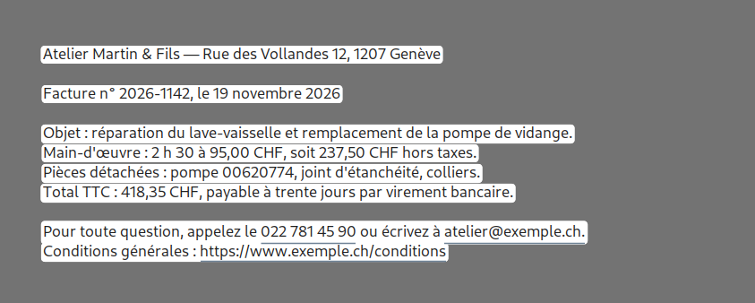

# Nori

Sélectionner et copier le texte des images, directement dans l’aperçu de Fichiers.

Appuyez sur <kbd>Espace</kbd> sur une image dans Fichiers : Nori en lit le
texte en arrière-plan. Vous pouvez ensuite le sélectionner à la souris comme
dans un document, le copier, ou ouvrir les liens, adresses électroniques et
numéros de téléphone qu’il contient. Tout se passe sur votre ordinateur, avec
[Tesseract](https://github.com/tesseract-ocr/tesseract) : rien n’est envoyé.



Nori est un plugin de **Sushi**, l’aperçu que Fichiers ouvre avec
<kbd>Espace</kbd>, et non une extension GNOME Shell : Sushi 51 charge des
plugins depuis `~/.local/share/sushi/plugins-1/`.

## Utilisation

| Geste | Effet |
|---|---|
| Glisser sur du texte | le sélectionner |
| Double-clic / triple-clic sur un mot | sélectionner le mot / la ligne |
| <kbd>Ctrl</kbd>+<kbd>C</kbd>, <kbd>Ctrl</kbd>+<kbd>A</kbd> | copier la sélection / tout sélectionner |
| Clic droit | Copier, Sélectionner tout le texte, Copier tout le texte, actions du lien, de l’adresse ou du numéro |
| Clic sur un lien, une adresse, un numéro | les mêmes actions |
| Boutons en bas à droite (au survol) | **Afficher le texte** assombrit l’image et fait ressortir chaque ligne ; **Copier tout le texte** |

### PDF scannés

Les pages de PDF sans texte (scans) sont lues elles aussi en arrière-plan,
pendant qu’un indicateur tourne dans la barre des pages. Nori pose ensuite
une couche de texte invisible sur ces pages et recharge l’aperçu à la même
page : la sélection, le double-clic et <kbd>Ctrl</kbd>+<kbd>C</kbd> de
l’aperçu PDF marchent alors sur le scan. Le fichier d’origine n’est jamais
modifié. Les longs scans sont lus à partir de la page affichée, en suivant
le lecteur ; l’aperçu se recharge dès que cette page a son texte, sans
perdre la position ni interrompre une sélection, et une fermeture puis une
réouverture reprennent là où la lecture s’était arrêtée (jusqu’à 200 pages).

## Installation

Il faut Sushi 51 ou plus récent (GNOME 51) et Tesseract avec les langues voulues :

```sh
sudo apt install tesseract-ocr tesseract-ocr-fra poppler-utils qpdf
./install.sh
```

`./install.sh --uninstall` le retire. Réglages facultatifs dans
`~/.config/nori/config.json` : `{"languages": ["fra", "eng"], "enabled": true}`.

Le fonctionnement, les mesures et le développement sont décrits dans le
[README anglais](README.md). Le suivi se fait dans les
[issues GitHub](https://github.com/d101c/nori/issues).
