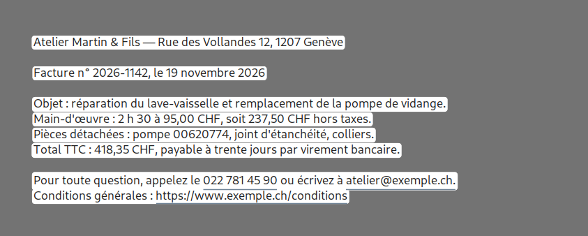
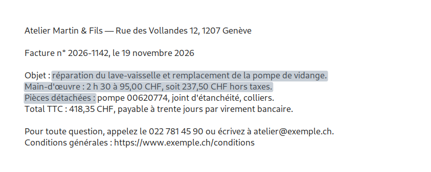

# Nori

Select and copy the text in images, right from GNOME's file previewer.

Press <kbd>Space</kbd> on an image in Files: Nori reads its text in the
background, and you can then select it with the mouse like in a document,
copy it, or open the links, e-mail addresses and phone numbers it contains.
Everything runs on your computer with [Tesseract](https://github.com/tesseract-ocr/tesseract);
nothing is sent anywhere.



Nori is a plugin for **Sushi**, the previewer that Files opens on
<kbd>Space</kbd>, not a GNOME Shell extension: Sushi 51 loads plugins from
`~/.local/share/sushi/plugins-1/`. Nori carries its own copies of Sushi's
image and PDF viewers (in `plugin/nori/vendor/`, as Sushi's maintainers
recommend) and only relies on Sushi's stable plugin API, so images and PDFs
load, animate and resize as before.

## Using it

| Action | Result |
|---|---|
| Drag over text | select it |
| Double-click / triple-click a word | select the word / the line |
| <kbd>Ctrl</kbd>+<kbd>C</kbd>, <kbd>Ctrl</kbd>+<kbd>A</kbd> | copy the selection / select all text |
| Right-click | Copy, Select All Text, Copy All Text, and actions for a link, e-mail address or phone number |
| Click a link, address or number | the same actions |
| Bottom-right buttons (on hover) | **Show Text** dims the picture and highlights every line; **Copy All Text** |

The pointer turns into a text cursor over text, as in a document. Double-clicking
outside text still toggles full screen.



### Scanned PDFs

PDF pages without text (scans, photos turned into PDFs) are read in the
background too; a spinner turns in the page bar meanwhile. Nori then lays an
invisible text layer over those pages, as OCRmyPDF does, and the preview
reloads at the same page: Sushi's own PDF selection, double-click and
<kbd>Ctrl</kbd>+<kbd>C</kbd> work on the scan. The original file is never
modified; the copy with text lives in `~/.cache/nori/pdf/` (500 MB at most,
least recently used first). Pages that already have text are left alone.

Long scans are read from the page on screen outwards, following you as you
move through the document. The preview reloads as soon as the page you are
looking at has its text (at most every 4 seconds, never while you are
selecting, keeping your scroll position), then once more at the end. Pages
read are cached one by one, so closing the preview and opening it again
resumes where it stopped. Up to 200 scanned pages are read
(`"maxPdfPages"` in the settings); `"pdf": false` turns this off.

## Install

Needs Sushi 51 or later (GNOME 51) and Tesseract with the languages you read:

```sh
sudo apt install tesseract-ocr tesseract-ocr-fra poppler-utils qpdf   # Debian, Ubuntu
sudo dnf install tesseract tesseract-langpack-fra poppler-utils qpdf  # Fedora
./install.sh
```

`poppler-utils` and `qpdf` are only needed for scanned PDFs.

`./install.sh --uninstall` removes it. `./install.sh --dev` links the plugin
to this checkout instead of copying it.

## Settings

Optional, in `~/.config/nori/config.json`:

```json
{"languages": ["fra", "eng"], "enabled": true, "pdf": true, "maxPdfPages": 200}
```

Without `languages`, Nori uses your session language plus English, and every
installed language when there are three or fewer (each extra language slows
recognition down).

## How it works

1. Sushi decodes the image (with Glycin, so EXIF rotation and every supported
   format are handled) and shows it at once.
2. 250 ms later, Nori takes those pixels, scales them to the size Tesseract
   reads best (small screenshots ×2, camera photos down to 3200 px), and
   pipes them to `tesseract` as an uncompressed PPM.
3. Words come back with their boxes (TSV). Nori drops low-confidence noise,
   groups words into lines, detects links, e-mail addresses and phone numbers,
   and draws selections over the picture.
4. The result is cached in `~/.cache/nori/` per file and modification time, so
   previewing the same image again is instant. Moving to another file cancels
   recognition.

For PDFs: `pdftotext` finds the pages without text; each one is rendered at
300 dpi (`pdftoppm`) and read by Tesseract as a text-only PDF page, three
pages at a time; `qpdf --overlay` lays them over the original pages (rotation
and page boxes included). Ubuntu confines qpdf with AppArmor to `*.pdf` files
in `/tmp` or non-hidden home folders, so this happens on copies in a
temporary folder. Sushi's PDF viewer is built from a GtkBuilder template that
GJS cannot subclass, so Nori wraps its copy of it rather than extending it.

Measured on an Intel i7-8565U (no GPU): 0.3 s for a dark-mode screenshot,
0.5 s for a scanned letter, 1.4 s for a 12-megapixel photo; a 40-page
scanned PDF has text on the page on screen after about 2 s and on every page
after about 16 s.

## Development

```sh
tests/run.sh               # unit tests + end-to-end runs on tests/fixtures
tools/sandbox.sh start     # a throwaway Sushi in a browser (GTK Broadway),
tools/sandbox.sh show F    # on a private D-Bus, with this checkout as plugin
NORI_DEBUG=1 ...           # log timings, selections and copies
gjs -m tools/render.js IMAGE OUT.png show-all   # render to PNG
gjs -m tools/pdf-drive.js SCAN.pdf 30 1500      # PDF preview, jump to page 30 after 1.5 s
```

Translations live in `po/`; `install.sh` compiles them.

## Roadmap and issues

Planned work and known limits are tracked in the
[GitHub issues](https://github.com/d101c/nori/issues).

## License

GPL-2.0-or-later, like Sushi.
